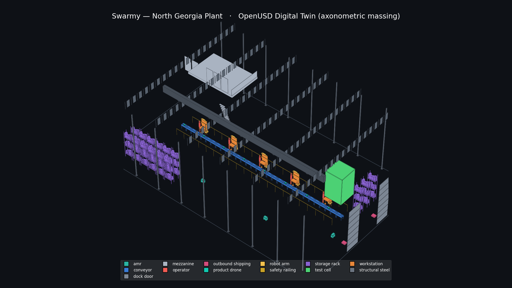
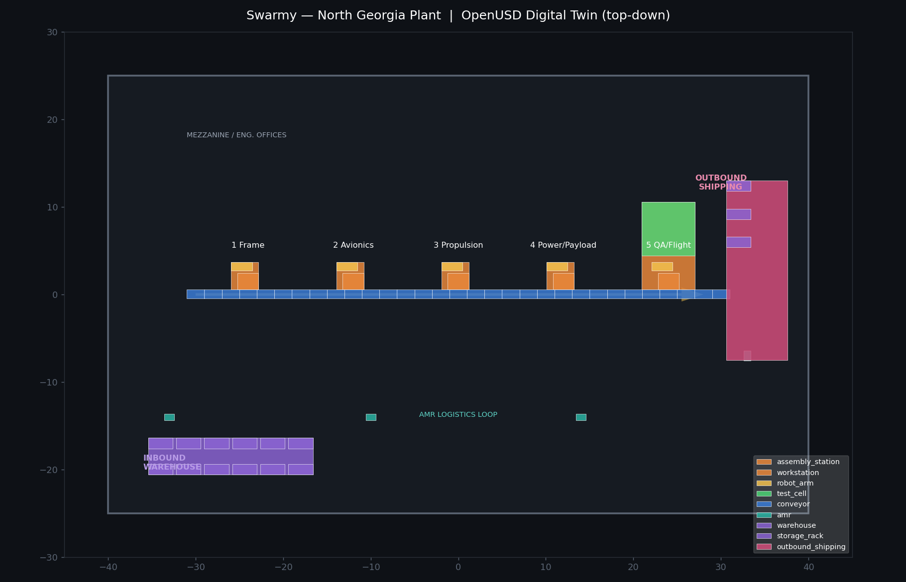

# Swarmy — North Georgia Plant · NVIDIA Omniverse Digital Twin

A runnable **OpenUSD digital twin** of a U.S. small-UAS (drone) manufacturing
facility, built for **layout & process visualization** and packaged to open on a
local **RTX workstation** in NVIDIA Omniverse (Kit / USD Composer).




The twin models **Swarmy's North Georgia Plant** (Gainesville, GA) — an
80 m × 50 m (4,000 m²) assembly facility producing the **Swarmy S-1 Scout**
quadcopter — with a five-station assembly line, a roller-conveyor spine, an AMR
logistics loop, inbound racking, an outbound shipping zone, a flight-test cage,
structural steel (columns + roof trusses), a glazed mezzanine, and a full
high-bay lighting rig. Every functional object carries SimReady-style semantic
metadata (`semantic:class` + `aif:core:*`) so the scene is ready for downstream
simulation, annotation, and data binding.

Both preview images above are rendered **directly from the composed USD** (no
GPU needed) — the axonometric massing view draws ~1,900 geometry leaves; the
floor plan is a top-down schematic of the line.

---

## 1. What's in the box

```
drone-factory-twin/
├── README.md                     ← you are here (architecture + deploy runbook)
├── requirements.txt              ← offline python deps (usd-core, numpy, matplotlib)
├── run.sh / run.bat              ← launch the twin in local Kit / USD Composer
├── regenerate.sh                 ← rebuild + validate + preview the USD (no GPU)
│
├── usd/                          ← the digital twin (OpenUSD)
│   ├── DroneFactory.usd          ← ROOT interface layer (open this one)
│   ├── isometric_preview.png     ← 3D massing rendered from the twin
│   ├── floorplan_preview.png     ← top-down plan rendered from the twin
│   ├── assets/
│   │   └── prototypes.usd         ← reusable component library (instanceable, self-contained materials)
│   └── layers/
│       ├── building.usd           ← shell + structural steel + services + floor zones + mezzanine
│       ├── layout.usd             ← 5 assembly stations on the central spine
│       ├── equipment.usd          ← conveyor, AMR fleet, warehouse & outbound racking
│       ├── lighting.usd           ← UsdLux dome + high-bay grid + test-cell key light
│       └── semantics.usd          ← non-destructive plant-level aif:core metadata
│
├── source/extensions/omni.swarmy.twin/   ← Omniverse Kit extension
│   ├── config/extension.toml
│   ├── omni/swarmy/twin/extension.py       ← menu, auto-open, process animation
│   └── docs/README.md
│
├── apps/
│   └── swarmy.twin.kit             ← standalone Kit viewer app definition
│
├── tools/generate_factory.py       ← the procedural USD generator
└── scripts/
    ├── validate.py                 ← headless composition check (asserts pass)
    ├── preview_floorplan.py        ← renders the top-down PNG from the USD
    └── preview_iso.py              ← renders the axonometric massing PNG from the USD
```

## 2. Architecture & USD composition

The twin follows NVIDIA's **SimReady / DSX** conventions: a thin **root
interface layer** composes purpose-built **sublayers**, and reusable geometry is
delivered as **instanceable references** to a prototype library.

```
DroneFactory.usd  (root interface — stage metadata, review camera)
   │  subLayers  (weakest → strongest)
   ├── layers/building.usd     shell / steel / services / zones / mezzanine
   ├── layers/layout.usd  ─────┐  references ┌──────────────────────┐
   ├── layers/equipment.usd ───┤────────────►│ assets/prototypes.usd │
   ├── layers/lighting.usd     │             │  RobotArm, Conveyor,   │
   └── layers/semantics.usd  ◄─┘ (overlay)   │  Workstation, AMR,     │
                                             │  StorageRack, Drone,   │
                                             │  TestCell, Operator    │
                                             └──────────────────────┘
```

Why this structure:
- **Sublayers** let disciplines (architecture, process, robotics, lighting) own a
  file each and merge non-destructively — the standard OpenUSD collaboration model.
- **`prototypes.usd` + instanceable references** mean the 30-odd conveyor
  segments, racks and AMRs share a single richly-detailed prototype in memory —
  fast to load and render on RTX. Each prototype carries its **own local
  materials** so bindings stay valid once referenced.
- **`semantics.usd` as the strongest layer** overlays plant-level `aif:core`
  metadata without touching geometry — mirroring the DSX "compose metadata onto
  geometry via sublayer composition" pattern.

Stage conventions: **Z-up**, **1 unit = 1 meter**, `kilogramsPerUnit = 1.0`,
`UsdPreviewSurface` materials, `UsdLux` lighting, `UsdPhysics` colliders on the
floor/walls and rigid bodies on conveyor-borne drones. The composed stage is
~600 top-level prims / ~1,900 geometry leaves and validates with **zero
composition warnings**.

### Component detail (prototype library)
Each component is built from primitives, capsules, cones and spheres for a
credible silhouette on an RTX viewport:
- **RobotArm** — articulated 6-axis: pedestal, rotating base, shoulder/elbow/
  wrist joints (spheres), tapered links (capsules), 2-finger gripper, cable pack.
- **ConveyorSegment** — side rails, 9 rollers, support legs, drive-motor box.
- **Workstation** — bench, pegboard + tools, dual monitors, parts bins, task
  light, anti-fatigue mat, stool.
- **StorageRack** — uprights, per-level beams + wire decks, mixed cartons.
- **AMR** — beveled chassis, twin safety lidars, e-stop, status bar, wheels + casters.
- **Drone (Swarmy S-1)** — carbon body + canopy, 4 arms, motor bells, 2-blade
  props, landing gear, gimbal + lens, antenna.
- **TestCell** — 6×6 m netted cage with top frame and landing pad.
- **Operator** — posed hi-vis technician with hard hat.

### Semantic schema (`aif:core:*`)
Every functional prim carries a friendly `semantic:class` token plus SimReady
core metadata, e.g. a station robot:

| key | value |
|---|---|
| `semantic:class` | `robot_arm` |
| `aif:core:manufacturer` | `FANUC` |
| `aif:core:model` | `M-20iD/25` |
| `aif:core:payload_kg` | `25` |
| `aif:core:reach_m` | `1.83` |

Plant-level metadata (on `/World`) records facility name (**Swarmy — North
Georgia Plant**), location, product (**Swarmy S-1 sUAS**), annual capacity, and
**NDAA §848 (Blue UAS) domestic-sourcing** compliance.

## 3. The modeled production line

| # | Station | Purpose |
|---|---|---|
| 1 | Frame & Chassis | Carbon-fiber arms + central plate build-up |
| 2 | Avionics / PCB | Flight-controller & ESC integration, wiring |
| 3 | Propulsion | Motor & propeller install, balancing |
| 4 | Power & Payload | Battery + camera/gimbal integration |
| 5 | Final QA / Flight | Calibration & flight test (netted cage) |

Support flow: **inbound warehouse → AMR loop → conveyor spine (stations 1-5) →
outbound shipping / dock doors**. Takt time, shifts and annual capacity are on
the `production_line` prim as semantics for downstream throughput analysis.

---

## 4. Deploy on a local RTX workstation

### Prerequisites
- Windows 10/11 or Linux with an **NVIDIA RTX GPU** (RTX 3070 / A4000 or better;
  driver 537+), 16 GB+ system RAM.
- **NVIDIA Omniverse** — either the **Kit SDK** (`kit`) or **USD Composer**.

### Option A — open the USD directly (fastest)
1. Launch **USD Composer**.
2. `File ▸ Open` → select `usd/DroneFactory.usd`.
3. Select the `ReviewCamera` (Cameras dropdown) for the framed hero angle.
4. Switch the renderer to **RTX – Interactive** (real-time) or **RTX – Path
   Traced** for beauty shots.

### Option B — run the packaged Kit app (with the process-viz extension)
1. Point `KIT_PATH` at your Kit/USD Composer executable (see the top of
   `run.sh` / `run.bat`).
2. Run: `./run.sh` (Linux/macOS) or `run.bat` (Windows).
3. The **omni.swarmy.twin** extension auto-opens the twin and adds a **Swarmy
   Twin** menu:
   - *Toggle Process Animation* flows drones along the conveyor.
   - *Print Selected Semantics* dumps a prim's `aif:core` data to the console.

> The `.kit` app (`apps/swarmy.twin.kit`) declares the standard RTX viewport
> stack plus our extension, and registers `source/extensions` as an extension
> search folder.

### Regenerate / edit the twin offline (no GPU)
```bash
pip install -r requirements.txt
python tools/generate_factory.py     # rebuild all USD layers
python scripts/validate.py           # headless composition check
python scripts/preview_floorplan.py  # top-down PNG
python scripts/preview_iso.py        # axonometric PNG
# or just:  ./regenerate.sh
```
Edit `tools/generate_factory.py` (the `FACILITY` block, station list, dimensions,
component geometry) and rerun to reshape the plant. In Omniverse, always author
into a **session/edit layer** rather than the root interface layer.

## 5. Where to take it next
- **Isaac Sim**: import the twin and swap the stylized `RobotArm`/`AMR`
  prototypes for real SimReady robot USDs to add physics, path planning and
  synthetic data generation.
- **Live telemetry**: bind MQTT/OPC-UA or an MES feed to the `assembly_station`
  and `conveyor_system` prims for a live operational twin.
- **Omniverse Cloud / OVX**: the plain-OpenUSD structure moves as-is; publish
  `DroneFactory.usd` to a Nucleus server and stream via the Omniverse Cloud APIs.
- **Higher fidelity**: replace procedural prototypes with SimReady/CAD assets and
  add MDL materials and real facility dimensions.

---
*Built with OpenUSD (`usd-core` 26.08) and Omniverse Kit conventions. Swarmy and
the S-1 Scout are fictional and for demonstration only.*
